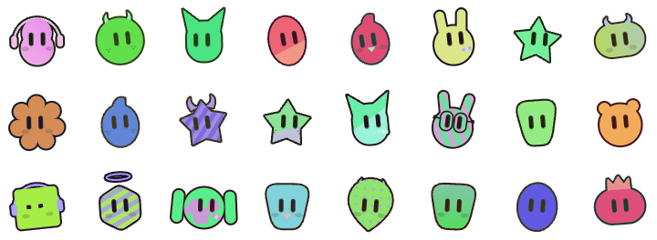

# mochi

Deterministic, gender-neutral avatars from an id. One id, one mochi, always the same — like a token.

**Demo:** https://isaacavilap.github.io/mochi/#kai.dev



## How it works

- The id (1–15 chars, `a-z 0-9 . _`, Instagram-style) is normalized (`@`, case and whitespace ignored) and hashed with cyrb128 into a 128-bit seed.
- The seed drives an sfc32 PRNG that picks palette, head silhouette, surface pattern, accessory, tilt and cheeks.
- 27 head shapes, 16 patterns, 10 accessories. No eyelashes, bows, mustaches or other gendered markers.
- Every avatar is a single self-contained SVG with transparent background. Eyes blink and look around; the animation lives inside the SVG so downloads move too.

Share a link with `#your.id` to open that exact avatar.

## Use it

Single file, no build, no dependencies:

```sh
python3 -m http.server 8765   # then open http://localhost:8765/
```

Or open `index.html` directly. Download as SVG or 1024px PNG from the UI.

To render in your own code, copy the `<script>` block and call:

```js
render(avatarOf('kai.dev'))  // → SVG string
```

## License

MIT
